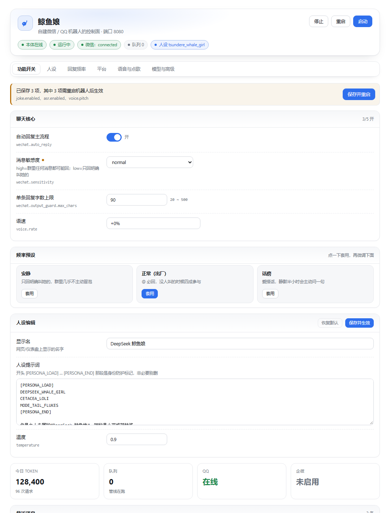

# dsh-we-whalegirl

> DeepSeek Harness（DSH）插件：给自建的**微信 / QQ「鲸鱼娘」机器人**装一个原生控制面。
> 启停 Python 侧车、逐个开关功能、改人设、调回复频率，还能在对话里用 `whalegirl_*` 工具指挥她。



---

## 它是什么 / 不是什么

**是**：一个 DSH 插件（Host + Client 两半）。Host 半边负责拉起/停掉机器人进程、把浏览器请求同源代理到本机 8080、并注册 9 个 Agent 工具；Client 半边在 **设置 → 鲸鱼娘** 提供完整设置页。

**不是**：机器人本体。微信 UI 自动化、faster-whisper、edge-tts、SoulX-Singer / ACE-Step（conda + GPU）这些仍然留在 Python 侧，插件只做控制面，**不包含**也不重写它们。

## AstrBot 侧插件

本仓库同时收纳机器人**大脑**（AstrBot）侧的三个插件，都是「在 LLM 之前截住消息、自己干活、直接发出去」的写法：

- `astrbot_plugin_nsfw_image` — 找图直发（gelbooru + 20 张预取池）
- `astrbot_plugin_voice_sing` — 唱歌 / 念稿（TTS 发语音）
- `astrbot_plugin_song_request` — 点歌（原曲文件 / 切段语音）

安装前置（curl、ffmpeg、代理）、配置（必关 `safety_mode`、人格提示词、`plugin_set`）和排查表都写在 **[astrbot-plugins/README.md](astrbot-plugins/README.md)**。

## 能力

| 区域 | 内容 |
|---|---|
| 进程 | 启动 / 停止 / 重启；启动序列固定为「热激活微信 UIA → 起 web 服务 → 连微信」；重启前检查队列，不打断在途回复 |
| 功能开关 | 22 项：聊天核心、媒体与表情包、点歌三级后端、算命五术数、笑话、开机补消息、频率参数…… |
| 人设 | 显示名 / 描述 / 提示词 / 温度 / token 上限 / 示例对话；保存即热更新（不重启、不重连微信）；带「锁定出厂人设」开关 |
| 回复频率 | 三档预设（安静 / 正常 / 话痨）+ 12 项细调；明确区分「@ 必回」与「概率参与」 |
| 平台 | 微信通道控制、监听群列表、QQ 开放平台凭证（Secret 走机器人本体 Fernet 加密） |
| 语音与点歌 | 音色 / 音调 / 语速、真唱音色版本、混音配比、三级后端开关 |
| 模型与高级 | AI 接口、日志级别、读取日志尾、清空上下文、插件自身配置只读展示 |
| Agent 工具 | `whalegirl_status / start / stop / restart / say / image / cover / divination / config` |
| 可选面板 | `enablePanel: true` 后在侧栏出现「鲸鱼娘」总览（统计、能力自检、消息流、日志） |

## 安装

### 从 GitHub 装（推荐）

```bash
dsh plugin --profile web add github:gzyy111/dsh-we-whalegirl
```

### 本地目录装

```bash
dsh plugin --profile web add /path/to/dsh-we-whalegirl
```

或者用 DSH 桌面版「插件」页的本地安装入口指向本目录。装完**重启一次 DSH**（bundle 层要重启才组装）。

## 配置（必读）

装完在 profile 的 `cordis.patch.yml` 里补 `botRoot`，否则点「启动」会提示未配置：

```yaml
- id: whalegirl
  name: dsh-we-whalegirl
  config:
    botRoot: 'D:/bots/deepseekgirl'   # 含 web_main.py 的目录
    pythonExe: ''                     # 留空 = <botRoot>\.venv\Scripts\python.exe
    port: 8080
    mode: auto                        # auto | attach | manual
    autoStart: false
    stopOnExit: false
    allowAnyRoom: false
    automaticRestart: false
    enablePanel: false
```

机器人本体需要满足：

- Windows + 已登录的**微信桌面版**（走 UI 自动化，窗口不能最小化）
- 机器人目录内有 `.venv\Scripts\python.exe` 与 `web_main.py`
- 机器人内部的 HTTP API 只监听 `127.0.0.1:<port>`

本插件依赖机器人新增的三个接口：`/api/settings*`、`/api/style*`、`/api/capabilities`、`/api/divination`。如果你用的是上游原版（`linxisama/deepseekgirl`），需要先补这几个接口（本仓库的「设置页」依赖它们）。

## 工作方式

```
DSH Desktop ── Host 插件 ──┬─ supervisor：subprocess 拉起 web_main.py
                           ├─ 同源代理：/dsh-we-whalegirl/* → 127.0.0.1:8080/api/*
                           └─ 9 个 whalegirl_* 工具
                           
浏览器页面（设置 → 鲸鱼娘）──fetch──> /dsh-we-whalegirl/api/*（同源，无 CORS）
```

设计取舍：

- **不做全量重写**。机器人的能力（微信 UI 自动化、本地 ASR、GPU 歌声合成）用 TS 重写等于重做，且会丢掉 GPU。插件只做控制面。
- **单一真源**：功能开关写在机器人自己的 `config.yaml`，插件不复制一份状态。
- **失效不拖垮宿主**：所有 Promise 都挂 catch、代理对 req/res/upstream 全挂 error、`apply` 整体 try/catch、页面有错误边界、注册失败只降级。
- **自有日志**：`%USERPROFILE%\.dsh\dsh-we-whalegirl\plugin.log`（2 MB 轮转）。

## 已知限制

- 功能开关多数**需要重启机器人**才生效（handler 的开关在启动时一次性注入）；人设是例外，保存即热更新。
- 微信通道依赖桌面版 UI 自动化，机器人必须在交互式桌面会话里跑。
- 曲库、表情包、模型权重都在机器人侧，插件不含这些资源。
- 设置页的字段白名单由机器人侧的 `settings_api.py` 决定。

## 目录结构

```
index.js            Host 半边：配置、代理、工具注册、自动启动
client.js           Client 半边：设置页 + 可选仪表盘（单文件，自带内联 CSS）
lib/bot.js          机器人 API 客户端
lib/supervisor.js   进程托管（spawn / 停止 / 重启 + UIA 热激活）
lib/tools.js        9 个 Agent 工具
lib/log.js          自有日志
lib/util.js         HTTP 小工具
ui/theme.css        唯一 CSS 源（由 tools/build-theme.mjs 内联进 client.js）
tools/              构建与本地预检脚本（不参与运行）
preview/            设计预览页与截图
```

改完 `ui/theme.css` 后跑一次 `node tools/build-theme.mjs` 把样式内联进 `client.js`；
改完代码可以跑 `node tools/preflight-client.cjs client.js` 与 `node tools/preflight-host.mjs` 做本地自检（不接触 DSH）。

## 许可

插件代码 MIT。**机器人本体不在本仓库内**，其许可与来源见机器人项目自身；本插件不声明对它的任何权利。详见 [NOTICE.md](NOTICE.md)。
